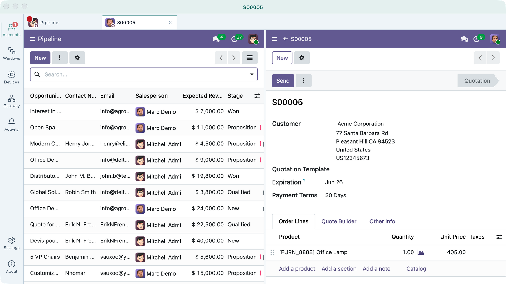
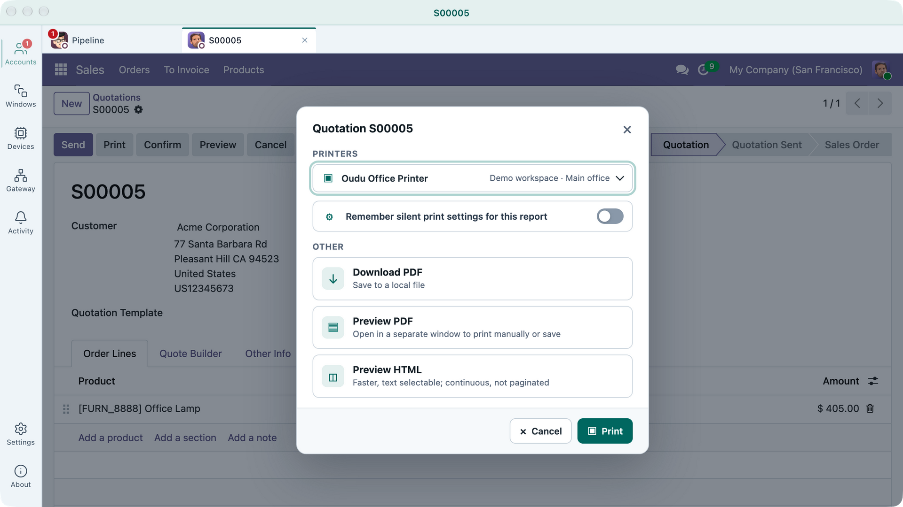
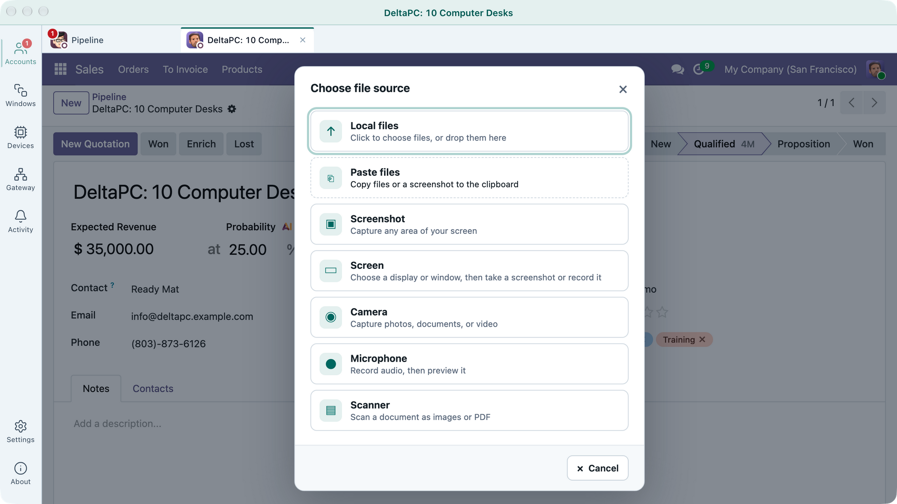
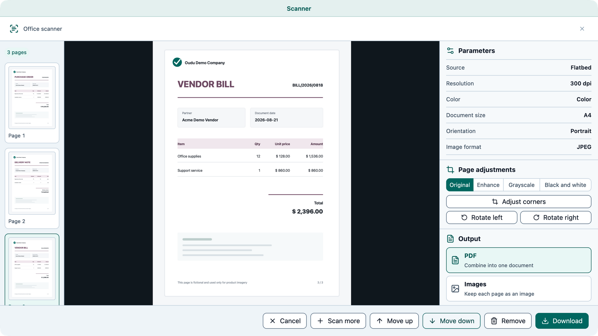
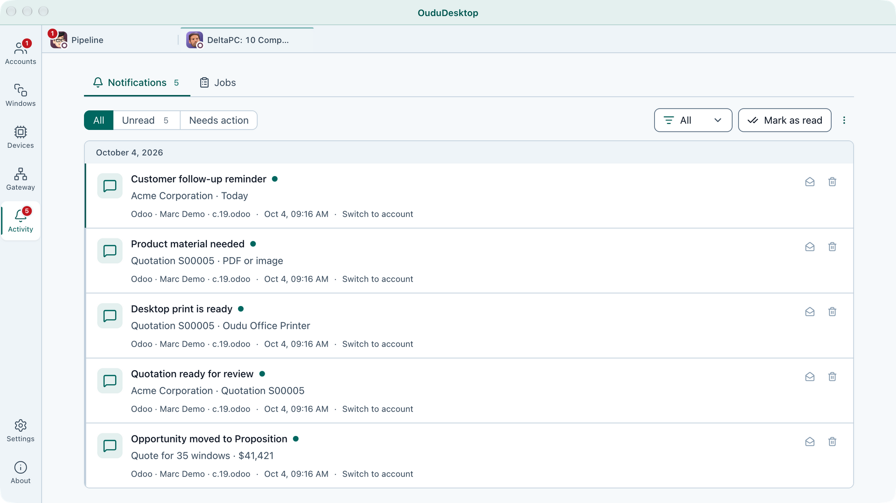
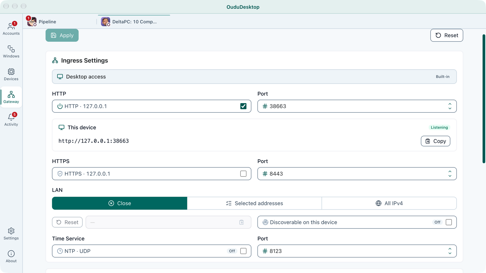
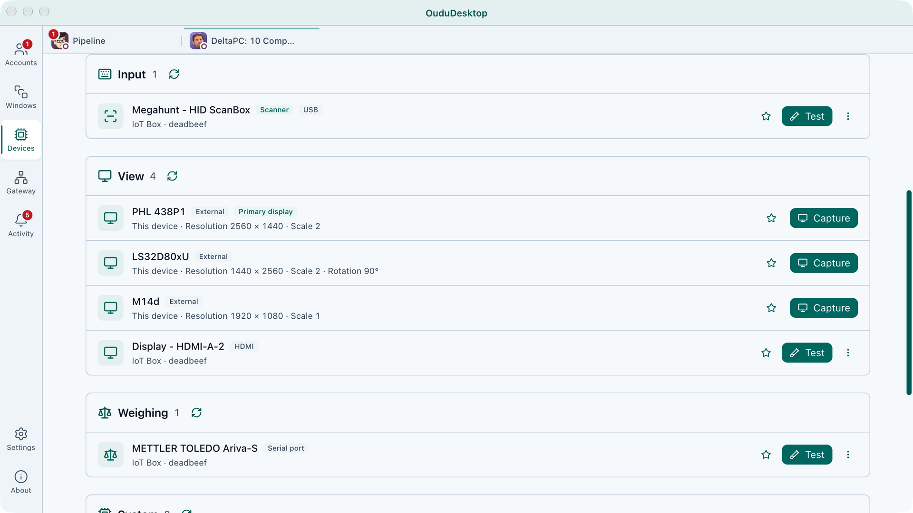
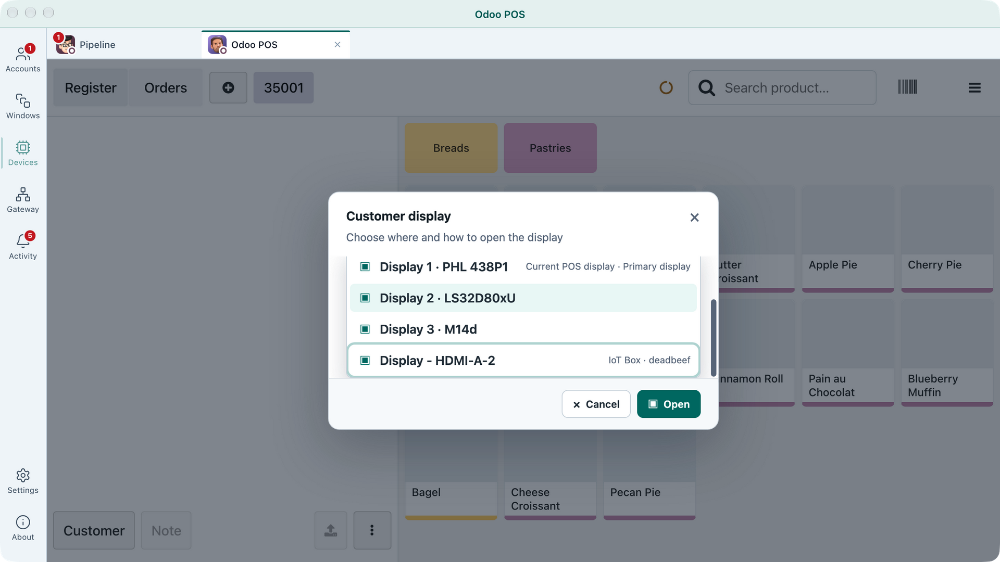
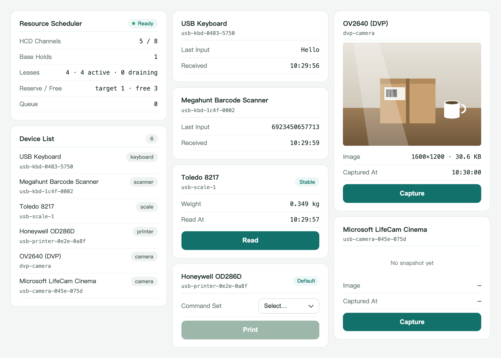
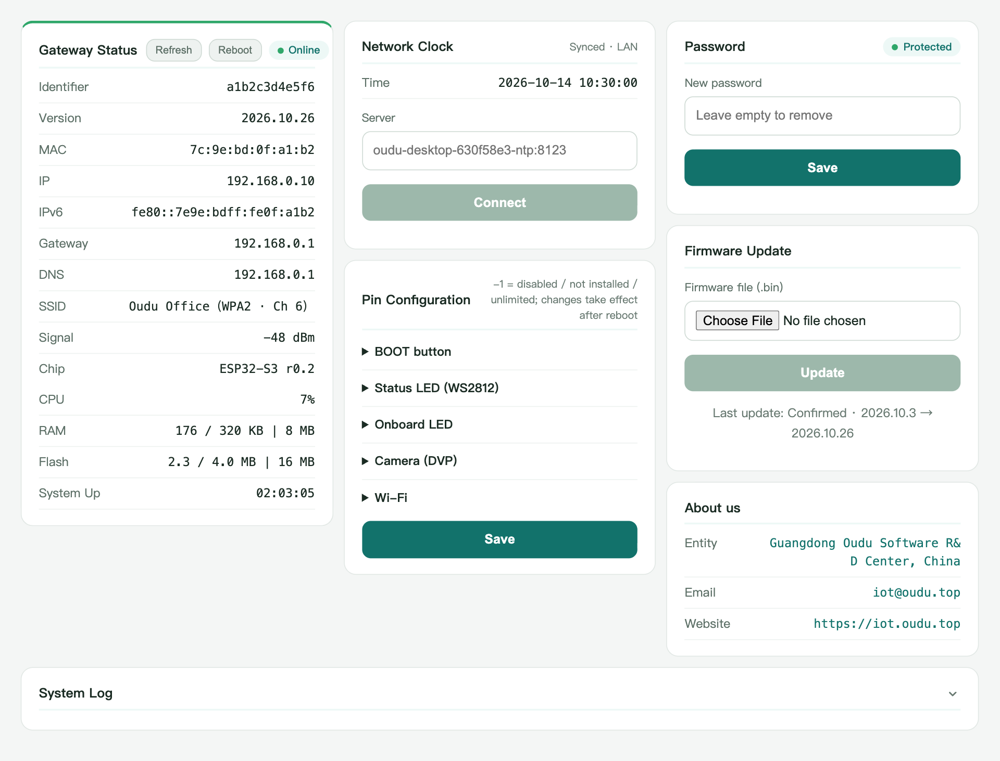

  <picture>
    <source media="(prefers-color-scheme: dark)" srcset="assets/brand/wordmark-en-on-dark.png">
    
  </picture>

# Oudu Addons — Free Odoo Tools and Native Integrations

Official open-source server modules for **Oudu Software** products. Add shared instance identity and a capability manifest to Odoo, connect your server to **Oudu Desktop**, the free native desktop client for Windows, macOS and Linux, and keep your **Oudu IoT** hardware gateways in one place.

## Choose your Odoo version

Each branch is a rolling snapshot of the latest compatible modules for that Odoo series.

| Odoo | Browse source | Download latest | Odoo Apps |
| --- | --- | --- | --- |
| 20.0 | [Browse 20.0](https://github.com/oudusoft/oudu_addons/tree/20.0) | [Download 20.0 ZIP](https://github.com/oudusoft/oudu_addons/archive/refs/heads/20.0.zip) | [Instance Identity](https://apps.odoo.com/apps/modules/20.0/oudu_base) · [Desktop](https://apps.odoo.com/apps/modules/20.0/oudu_desktop) · [IoT](https://apps.odoo.com/apps/modules/20.0/oudu_iot) |
| 19.0 | [Browse 19.0](https://github.com/oudusoft/oudu_addons/tree/19.0) | [Download 19.0 ZIP](https://github.com/oudusoft/oudu_addons/archive/refs/heads/19.0.zip) | [Instance Identity](https://apps.odoo.com/apps/modules/19.0/oudu_base) · [Desktop](https://apps.odoo.com/apps/modules/19.0/oudu_desktop) · [IoT](https://apps.odoo.com/apps/modules/19.0/oudu_iot) |
| 18.0 | [Browse 18.0](https://github.com/oudusoft/oudu_addons/tree/18.0) | [Download 18.0 ZIP](https://github.com/oudusoft/oudu_addons/archive/refs/heads/18.0.zip) | [Instance Identity](https://apps.odoo.com/apps/modules/18.0/oudu_base) · [Desktop](https://apps.odoo.com/apps/modules/18.0/oudu_desktop) · [IoT](https://apps.odoo.com/apps/modules/18.0/oudu_iot) |
| 17.0 | [Browse 17.0](https://github.com/oudusoft/oudu_addons/tree/17.0) | [Download 17.0 ZIP](https://github.com/oudusoft/oudu_addons/archive/refs/heads/17.0.zip) | [Instance Identity](https://apps.odoo.com/apps/modules/17.0/oudu_base) · [Desktop](https://apps.odoo.com/apps/modules/17.0/oudu_desktop) · [IoT](https://apps.odoo.com/apps/modules/17.0/oudu_iot) |
| 16.0 | [Browse 16.0](https://github.com/oudusoft/oudu_addons/tree/16.0) | [Download 16.0 ZIP](https://github.com/oudusoft/oudu_addons/archive/refs/heads/16.0.zip) | [Instance Identity](https://apps.odoo.com/apps/modules/16.0/oudu_base) · [Desktop](https://apps.odoo.com/apps/modules/16.0/oudu_desktop) · [IoT](https://apps.odoo.com/apps/modules/16.0/oudu_iot) |
| 15.0 | [Browse 15.0](https://github.com/oudusoft/oudu_addons/tree/15.0) | [Download 15.0 ZIP](https://github.com/oudusoft/oudu_addons/archive/refs/heads/15.0.zip) | [Instance Identity](https://apps.odoo.com/apps/modules/15.0/oudu_base) · [Desktop](https://apps.odoo.com/apps/modules/15.0/oudu_desktop) · [IoT](https://apps.odoo.com/apps/modules/15.0/oudu_iot) |
| 14.0 | [Browse 14.0](https://github.com/oudusoft/oudu_addons/tree/14.0) | [Download 14.0 ZIP](https://github.com/oudusoft/oudu_addons/archive/refs/heads/14.0.zip) | [Instance Identity](https://apps.odoo.com/apps/modules/14.0/oudu_base) · [Desktop](https://apps.odoo.com/apps/modules/14.0/oudu_desktop) · [IoT](https://apps.odoo.com/apps/modules/14.0/oudu_iot) |
| 13.0 | [Browse 13.0](https://github.com/oudusoft/oudu_addons/tree/13.0) | [Download 13.0 ZIP](https://github.com/oudusoft/oudu_addons/archive/refs/heads/13.0.zip) | [Instance Identity](https://apps.odoo.com/apps/modules/13.0/oudu_base) · [Desktop](https://apps.odoo.com/apps/modules/13.0/oudu_desktop) · [IoT](https://apps.odoo.com/apps/modules/13.0/oudu_iot) |

## Free modules

| Module | Odoo series | What it provides |
| --- | --- | --- |
| `oudu_base` | 13.0–20.0 | Shared Oudu Software settings, instance name/color/icon, and the public capability manifest. |
| `oudu_desktop` | 13.0–20.0 | Desktop capability contribution, connection guide, direct report print policy, file upload policy, and local source controls. |
| `oudu_iot` | 13.0–20.0 | Oudu IoT host list, browser connection test, gateway shortcut and Point of Sale setup hint. |

All modules install and remain usable in a standard web browser. Oudu Desktop adds native capabilities without modifying Odoo itself.

## Oudu Desktop

Oudu Desktop hosts Odoo's own frontend while keeping every server and account in an isolated session. Work across several Odoo environments at once, print reports directly, and use local files and devices without leaving your desktop.

- **Multiple instances and accounts** — keep several Odoo servers or identities online side by side.
- **Direct report printing** — send reports to system and network printers with routing and history.
- **Local files and devices** — use native file sources, screenshots, cameras, microphones and scanners through explicit controls.
- **Native desktop experience** — windows, tray, notifications, badges, downloads and shortcuts.

### Multi-page scanning and export

Scan business documents, reorder or remove pages, adjust their appearance, then export one PDF or a set of images.

### One activity center across accounts

Keep Odoo messages, desktop jobs and items that need attention together without losing their account context.

### One gateway for desktop and LAN devices

Manage desktop, HTTP, HTTPS, LAN and IoT access capabilities from one Gateway Center.

### Scanners, scales and displays in one Device Center

List barcode scanners, scales and displays, choose defaults and run tests without leaving the app.

### Customer display from Odoo POS

Pick a local display or an IoT Box display from Odoo POS and present in fullscreen or windowed mode.

**Free download: [desktop.oudu.top](https://desktop.oudu.top) · [Microsoft Store](https://apps.microsoft.com/detail/9NK0Z5PVPGJJ)**

## Oudu IoT

Oudu IoT is an ESP32 edge hardware gateway for Odoo. Barcode scanners, scales, receipt printers and cameras connect through the IoT Box and ePOS interfaces Odoo already speaks, so the devices work with standard Odoo 8–20 even without these addons.

The optional `oudu_iot` module gives administrators one host list under **Oudu → IoT → Hosts**, a connection test run from the browser (Google Chrome or Microsoft Edge), a shortcut to each host's own gateway page, and a hint showing where to enter the host in Point of Sale.

**Flash online and learn more: [iot.oudu.top](https://iot.oudu.top)**

## Compatibility

These server addons support **Odoo 13–20**. Each supported series is built from one private source tree and tested in its matching Odoo runtime before publication.

The Oudu Desktop client can still connect to Odoo 8–12 without these server addons; those older servers keep their normal Odoo behavior and simply do not expose the optional capability manifest and policies.

## Installation

1. Select the branch matching your Odoo series, such as `20.0` or `13.0`.
2. Copy `oudu_base`, `oudu_desktop` and `oudu_iot` into an addons path.
3. Update the Apps list and install **Oudu Desktop**, **Oudu IoT** or both; Odoo installs `oudu_base` as their dependency.
4. Open **Settings → Oudu Software** to set the shared instance identity and product settings.

Every public branch is a generated, self-contained snapshot with one commit. Development history and compatibility transforms stay outside this distribution repository, so branch contents should not be edited by hand.

## Links

- Oudu Software: [oudu.top](https://oudu.top)
- Oudu Desktop: [desktop.oudu.top](https://desktop.oudu.top)
- Oudu IoT: [iot.oudu.top](https://iot.oudu.top)
- Contact: [info@oudu.top](mailto:info@oudu.top)
- License: LGPL-3.0

---

## 中文简介

本仓库提供欧度软件产品的官方开源 Odoo 服务端模块：

- `oudu_base`：统一的“欧度软件”设置入口、实例名称/颜色/图标与聚合能力清单；
- `oudu_desktop`：向聚合能力清单贡献 Oudu Desktop 策略，并提供连接引导、报表打印策略、文件上传策略与本地来源控制；
- `oudu_iot`：Oudu IoT 主机清单、浏览器连接测试、网关入口与 POS 接入提示。Oudu IoT 设备本身经 Odoo 原生 IoT Box/ePOS 接口工作，不装模块也能用于标准 Odoo 8–20。

服务端模块支持 **Odoo 13–20**，每个系列都由同一私有真源生成，并在对应 Odoo 运行时通过门禁后发布。Oudu Desktop 客户端仍可直接连接 Odoo 8–12，但这些旧系列不提供可选的服务端模块能力。

**选择 Odoo 版本：** [20.0](https://github.com/oudusoft/oudu_addons/tree/20.0) · [19.0](https://github.com/oudusoft/oudu_addons/tree/19.0) · [18.0](https://github.com/oudusoft/oudu_addons/tree/18.0) · [17.0](https://github.com/oudusoft/oudu_addons/tree/17.0) · [16.0](https://github.com/oudusoft/oudu_addons/tree/16.0) · [15.0](https://github.com/oudusoft/oudu_addons/tree/15.0) · [14.0](https://github.com/oudusoft/oudu_addons/tree/14.0) · [13.0](https://github.com/oudusoft/oudu_addons/tree/13.0)

模块在普通浏览器中也能正常安装使用；配合免费的 Oudu Desktop，可获得多实例、报表直接打印、本地文件与设备以及原生桌面体验。

免费下载：[desktop.oudu.top](https://desktop.oudu.top) ｜ [Microsoft Store](https://apps.microsoft.com/detail/9NK0Z5PVPGJJ) ｜ Oudu IoT：[iot.oudu.top](https://iot.oudu.top) ｜ 官网：[oudu.top](https://oudu.top) ｜ 联系：[info@oudu.top](mailto:info@oudu.top)
